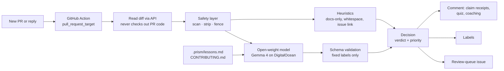

# 🔷 PRism: make pull requests trustworthy again

**An open-source review shield for open-source maintainers, running on open-weight models you can host yourself.**

Built by **Team Cryptix** for Hacktoberfest Hack Day Delhi × SKILLOP DTU.
Runs on **Gemma 4**, served by **DigitalOcean Inference**, the Gemini API, or fully locally with Ollama.

> Other tools ask *"did AI write this?"* or *"do we know you?"*
> PRism asks *"do you understand what you changed?"*, and lets you prove it.

---

## The problem

For 12 years, Hacktoberfest counted pull requests. In 2026 it stopped: organizers said low-effort PRs had become too easy to churn out, and maintainers were paying for them in review time and burnout. Across open source, projects are responding by banning AI contributions, closing PRs to outsiders, or gating who may contribute at all.

Those fixes protect maintainers, but they also lock out the genuine beginners open source depends on. PRism is the middle path: keep the door open, and make every PR prove its worth before it costs a maintainer their attention.

## What PRism does on every pull request

| | Feature | What it means |
|---|---|---|
| 🧾 | **Claim receipts** | Splits the PR description into claims ("fixes #12", "adds tests") and checks each one against the diff: ✅ verified, ❔ unverified, ❌ contradicted. Evidence, not a mystery score. |
| 🧠 | **Earn your vouch** | Asks the contributor two questions about *their own diff*, then grades the reply against the code. Pass → `prism:verified-understanding`. Using AI to write code is fine; understanding it is what counts. |
| 🛡️ | **Injection-proof by design** | Hidden HTML comments, invisible characters and "ignore previous instructions" text are detected, stripped before the model sees them, and flagged as `prism:injection-attempt`. |
| 📚 | **Learns from maintainers** | `/prism wrong <reason>` and `/prism right` save a lesson to `.prism/lessons.md`. PRism reads recent lessons before every review. No training, fully reviewable in git. |
| 🤝 | **Trust that's earned** | `/prism vouch` adds the contributor to `.prism/trusted.txt`; trusted contributors skip the quiz. |
| 📋 | **Review queue** | A pinned issue ranks open PRs by priority, so maintainers review from the top. |
| 🖼️ | **Screenshot check** | Gemma 4 is multimodal: screenshots in a UI PR are compared with what the PR claims to change. |
| 🧭 | **Contributor preflight** | Contributors run the same checks *before* opening a PR, with coaching and a practice quiz. Slop stopped at the source. |
| 🔁 | **Model-agnostic harness** | Any OpenAI-compatible endpoint. Swap Gemma 4 for Qwen, Llama, Mistral or gpt-oss with one setting. |

PRism **never closes, merges or approves** anything. It labels and ranks; a maintainer always decides. A wrong call costs one click, not a contributor's work.

## How it works



## Security model

AI agents in GitHub Actions have been hijacked through text in PR titles, issue bodies and hidden HTML comments. A spam filter is an obvious target, so PRism is built so that a successful injection has nothing to grab:

- **No PR code runs.** The diff is read through the API. The workflow checks out the base branch only.
- **The model has no tools and no secrets.** It receives text and returns one JSON object.
- **Untrusted text is fenced** inside random, unguessable delimiters that an attacker cannot close.
- **Output is validated.** Verdicts come from a fixed list; PRism recomputes quiz results from the per-question scores; mentions, links and HTML are neutralised before posting.
- **State is tamper-proof.** Only the bot's own comments can carry PRism state; markers in anyone else's comments are ignored.
- **Manipulation is a signal.** Trying to steer the reviewer earns `prism:injection-attempt`, whatever the model says.

## How PRism compares

Based on public descriptions of each tool (October 2026). Each one solves a real part of the problem; PRism combines the parts and adds what we found missing.

| | Pattern-based slop detectors | anti-slop | Vouch | BitSpam (hackathon) | **PRism** |
|---|---|---|---|---|---|
| Reads what the change does | ❌ | partial | ❌ | ✅ | ✅ |
| Per-claim evidence | ❌ | ❌ | ❌ | partial | ✅ |
| Grades the contributor's answers | ❌ | ❌ | ❌ | asks only | ✅ |
| Learns from maintainer corrections | ❌ | ❌ | manual list | planned | ✅ |
| Open-weight, self-hostable model | n/a | n/a | n/a | ❌ | ✅ |
| Built-in injection defence | n/a | n/a | n/a | not stated | ✅ |
| Contributor-side preflight | ❌ | ❌ | ❌ | ❌ | ✅ |
| Never auto-closes | varies | ❌ | blocks | ✅ | ✅ |

## Quick start (5 minutes)

1. Copy `.github/workflows/prism.yml` into your repository (or use this repo directly).
2. Add **one** repository secret (*Settings → Secrets and variables → Actions*):
   - `GEMINI_API_KEY`: a **free** key from Google AI Studio (aistudio.google.com → Get API key; no card needed). Serves Gemma 4. **Or**
   - `DO_MODEL_KEY`: a DigitalOcean model access key (*Inference Hub → model access keys*), to run Gemma 4 on DigitalOcean.
3. Optional repository variables:
   - `PRISM_MODEL`: model id. Defaults to `gemma-4-26b-a4b-it`. If your provider names it differently, PRism's error message lists the Gemma models your key can use.
   - `PRISM_PROVIDER`: `digitalocean`, `gemini`, `ollama` or `custom` (auto-detected from the secret).
   - `PRISM_QUIZ_EVERYONE`: `true` to quiz collaborators too (useful for demos).
4. Open a pull request. PRism comments within a minute.

**Self-hosted and free:** run `ollama pull gemma4` on your own machine or a DigitalOcean GPU Droplet, set `PRISM_PROVIDER=custom` and `PRISM_BASE_URL=http://<host>:11434/v1`, and no code leaves your infrastructure.

### Maintainer commands (comment on a PR)

| Command | Effect |
|---|---|
| `/prism right` | Confirms the verdict; saved as a lesson |
| `/prism wrong <reason>` | Corrects the verdict; PRism reads this before future reviews |
| `/prism vouch` | Trusts the PR author; their future PRs skip the quiz |

### For contributors: check before you submit

```bash
export DO_MODEL_KEY=...        # or GEMINI_API_KEY, or run Ollama locally
python3 -m prism.cli preflight --base main --body-file my-pr-description.md
```

### Agent skills

`skills/` contains two skills for coding agents that support `SKILL.md` (Claude Code, OpenCode and others):
- **prism-maintainer-triage**: "triage my open PRs" → a ranked queue with red flags first.
- **prism-contributor-preflight**: "is my PR ready?" → runs preflight and coaches the contributor, without answering the quiz for them.

## Try the demo

`examples/seed_demo.sh` creates one issue and three PRs against the `demo/` module:

1. **A genuine fix** with a test → 🟢 looks good, ✅ claims verified, quiz asked.
2. **A README full stop** → 🔴 likely spam, lowest priority.
3. **A plausible AI refactor** that claims to fix the bug and add tests (it does neither) and hides an instruction for the AI reviewer → 🟣 manipulation attempt, ❌ contradicted claims.

## Honest limitations

- **The quiz raises the cost of slop; it is not proof.** A determined contributor can ask an AI to answer it too. That's why PRism only labels and ranks, and the maintainer decides.
- **Model judgments can be wrong.** Every verdict shows its evidence, and `/prism wrong` exists for exactly this.
- **Large diffs are truncated** to fit the model's context; PRism says so when it happens.
- **Injection detection is pattern-based** on top of structural defences. The structural defences (no tools, no secrets, fixed outputs) are what make a missed pattern harmless.
- **Hosted models may cost money.** The software is free; for a zero-cost model, self-host with Ollama.

## Development

Standard library only, Python 3.10+. No dependencies to install.

```bash
python3 -m unittest discover -s tests -v   # 23 offline tests with a fake model and fake GitHub
```

```
prism/
  llm.py         model-agnostic OpenAI-compatible client (DigitalOcean, Gemini, Ollama, custom)
  safety.py      injection scan, stripping, fencing, output sanitising
  heuristics.py  cheap deterministic signals
  analyze.py     claim receipts, issue fit, quiz generation and grading, decision
  memory.py      lessons and trusted-contributor files
  render.py      GitHub comments and tamper-proof state
  main.py        GitHub Action entry point
  cli.py         contributor preflight
skills/          agent skills for maintainers and contributors
```

## License

MIT. Free to use, fork and self-host.
